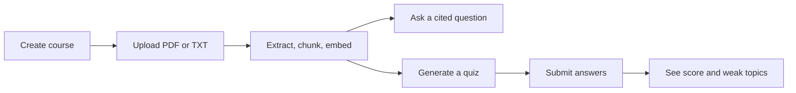
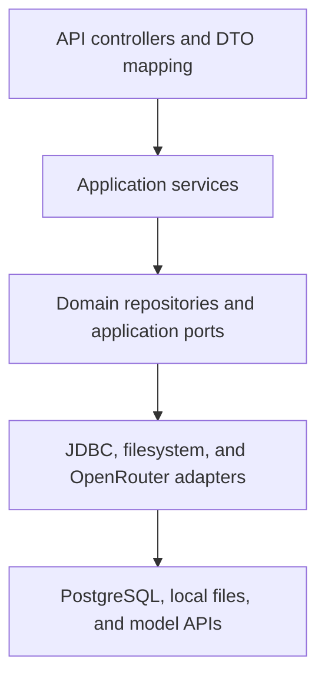
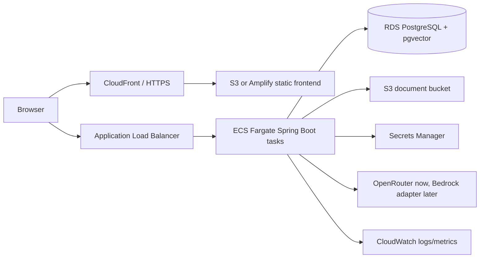

# Study Companion: Developer and Deployment Guide

This guide explains the product, its current implementation, and a path from the local demo to GitHub and AWS. It is written to help you reason through the code rather than just start the services.

## 1. Product and business understanding

Study Companion helps a learner turn class notes into three things:

1. **Understand:** ask questions about notes and get an answer tied to passages in those notes.
2. **Practice:** create a short quiz based on the notes and get deterministic scoring.
3. **Improve:** see which quiz topics need more review.

The product promise is “help me study from my own materials.” That promise drives an important design rule: answers and quizzes should use the selected course’s uploaded documents as their context. If retrieval finds no supporting passages, the chat should say so instead of guessing.

### Main user journey



### Core business objects

- **Course:** a learning space and the data-isolation boundary for documents, conversations, quizzes, and progress.
- **Document:** an uploaded PDF or text file, with a status of `PROCESSING`, `READY`, or `FAILED`.
- **Chunk:** a short piece of extracted document text. Each chunk keeps its course/document IDs and, for PDFs, its page number.
- **Conversation/message:** the persisted question and answer history for a course.
- **Quiz/submission:** a generated set of questions, its hidden answer key, and a learner’s submitted answers and score.

The app is currently single-user and has no sign-in. Course scoping prevents retrieval from crossing course boundaries; it is not a substitute for user-level authorization in a multi-user product.

## 2. System overview

The React browser calls the Spring Boot REST API. Controllers map requests to application services, which use repository interfaces for PostgreSQL and provider/storage ports for the model API and uploaded files. Flyway manages database schema changes.

The frontend and backend are separate applications in one repository. The backend owns validation, persistence, retrieval, model calls, quiz scoring, and document processing. The browser owns presentation and user interaction; it does not make model calls directly.

### Current technologies

| Area | Technology | Role in this project |
| --- | --- | --- |
| Frontend | React, TypeScript, Vite, CSS, Lucide | Single-page study workspace and REST client |
| Backend | Java 21, Spring Boot 3.5, Spring Web, JDBC | REST API and application logic |
| AI integration | Spring AI 1.1, `StudyAiProvider`, OpenRouter | Chat generation, structured quiz output, and embeddings |
| Relational data | PostgreSQL 17, Flyway | Courses, documents, conversations, quizzes, and progress |
| Vector search | pgvector, cosine distance, HNSW index | Similarity search over embedded chunks |
| PDF extraction | Apache PDFBox | Text extraction while preserving page numbers |
| Local services | Docker Compose | Local PostgreSQL with pgvector |
| Tests | Vitest/Testing Library, JUnit/Mockito | UI behavior and backend logic checks |

## 3. Frontend

### What the frontend does

The frontend is a single-page React app. The main view has a course list and a selected course workspace. The workspace switches between Learn, Practice, and Progress sections without navigating to separate pages.

Key files:

- [`frontend/src/App.tsx`](../frontend/src/App.tsx): page composition, course/document/chat/quiz state, and event handlers.
- [`frontend/src/api.ts`](../frontend/src/api.ts): TypeScript response types and the `fetch` wrapper for the API.
- [`frontend/src/styles.css`](../frontend/src/styles.css): layout, colors, responsive rules, and loading states.
- [`frontend/src/App.test.tsx`](../frontend/src/App.test.tsx): UI tests for course, upload, cited chat, quiz, and submission flows.

### Frontend state and flow

1. On load, `App` calls `GET /api/courses` and selects a course.
2. The selected course ID is kept in browser local storage so a refresh returns to the same course. When a course is selected, the app calls `GET /api/courses/{courseId}/documents` and `GET /api/courses/{courseId}/chat`. The latter restores the course’s saved messages and citations, and returns the latest conversation ID so new questions continue that conversation.
3. Upload sends a browser `FormData` object to the documents endpoint. The browser sets the multipart boundary; frontend code should not hard-code a `Content-Type` header for this request.
4. While any document is `PROCESSING`, the UI refreshes the course’s document list every **5 seconds**. It stops polling when the API returns no processing documents.
5. Chat, quiz creation, submission, and progress each call the matching REST endpoint through `api.ts`.

The frontend does not hold model credentials. It only sees the API response, including source references returned by the backend.

### Frontend limitations to know

- It is a single-page application without a routing library.
- Chat messages are persisted by the backend, but there is no endpoint/UI yet to reload conversation history after a page refresh.
- The default API URL is `http://localhost:8080/api`; production must set `VITE_API_BASE_URL` at frontend build time.
- `pnpm test` runs the UI tests; `pnpm build` performs TypeScript checking and creates production static assets in `frontend/dist/`.

## 4. Backend

### Layering and design patterns

The backend is organized as a small ports-and-adapters application. Dependencies point inward from HTTP and database/model integrations toward application workflows and domain types:



- **Controllers** translate HTTP inputs into application calls and return response DTOs. Each controller owns one API area.
- **Request and response DTOs** live in separate files under `api/dto`. They are transport shapes; they do not double as database entities or model output types.
- **`ApiMapper`** converts domain results to response DTOs. This keeps HTTP serialization concerns out of application services.
- **Application services** coordinate use cases and enforce rules such as upload limits, course ownership, quiz validation, scoring, and retrieval behavior.
- **Domain models** are Java records such as `Course`, `StudyDocument`, `Quiz`, and `QuizQuestion`. They stay independent of persistence annotations.
- **Repository interfaces** under `domain/repository` describe required persistence operations. Infrastructure adapters implement them and keep persistence details out of application services.
- **Outbound ports and adapters:** application services depend on `StudyAiProvider`. The OpenRouter-specific Spring AI adapter lives under `infrastructure/ai/openai`; a Bedrock implementation can satisfy the same port.
- **Configuration** is centralized: `AppProperties` binds the `app.*` settings, `AsyncConfiguration` controls document ingestion workers, and `WebConfig` configures CORS.
- **Database connection:** Spring Boot auto-configures one `DataSource` from `spring.datasource.*` in `application.yml`. JPA repositories and `JdbcTemplate` use that same source, so both approaches participate in Spring-managed database access.
- **Schema evolution:** Flyway migration files own database changes. Repositories must match the schema; do not edit an already-applied migration when adding future changes.

These are common enterprise patterns scaled to the size of this application: dependency inversion, repository abstraction, DTO mapping, constructor injection, immutable records, bounded asynchronous execution, and deterministic business rules. Course and document metadata use JPA for routine persistence, while explicit JDBC remains for pgvector and JSONB operations where the SQL is clearer and more specialized.

### Important backend areas

- [`StudyCompanionApplication.java`](../backend/src/main/java/dev/studycompanion/StudyCompanionApplication.java): starts Spring Boot and discovers configuration properties.
- [`CourseController.java`](../backend/src/main/java/dev/studycompanion/api/controller/CourseController.java), [`DocumentController.java`](../backend/src/main/java/dev/studycompanion/api/controller/DocumentController.java), [`ChatController.java`](../backend/src/main/java/dev/studycompanion/api/controller/ChatController.java), and [`QuizController.java`](../backend/src/main/java/dev/studycompanion/api/controller/QuizController.java): focused HTTP controllers.
- [`CreateCourseRequest.java`](../backend/src/main/java/dev/studycompanion/api/dto/request/CreateCourseRequest.java) and response records in `api/dto/response`: API contract types.
- [`ApiMapper.java`](../backend/src/main/java/dev/studycompanion/api/mapper/ApiMapper.java): maps application/domain results to response DTOs.
- [`Course.java`](../backend/src/main/java/dev/studycompanion/domain/model/Course.java), [`StudyDocument.java`](../backend/src/main/java/dev/studycompanion/domain/model/StudyDocument.java), and the other `domain/model` records: core data types independent of HTTP and JDBC.
- [`CourseRepository.java`](../backend/src/main/java/dev/studycompanion/domain/repository/CourseRepository.java) and sibling interfaces: persistence contracts.
- [`JpaCourseRepositoryAdapter.java`](../backend/src/main/java/dev/studycompanion/infrastructure/persistence/jpa/JpaCourseRepositoryAdapter.java) and [`JpaDocumentRepositoryAdapter.java`](../backend/src/main/java/dev/studycompanion/infrastructure/persistence/jpa/JpaDocumentRepositoryAdapter.java): adapt Spring Data JPA persistence to the domain repository contracts.
- [`CourseJpaRepository.java`](../backend/src/main/java/dev/studycompanion/infrastructure/persistence/jpa/repository/CourseJpaRepository.java) and [`DocumentJpaRepository.java`](../backend/src/main/java/dev/studycompanion/infrastructure/persistence/jpa/repository/DocumentJpaRepository.java): Spring Data repositories and a course-count projection.
- [`JdbcDocumentChunkRepository.java`](../backend/src/main/java/dev/studycompanion/infrastructure/persistence/jdbc/JdbcDocumentChunkRepository.java), [`JdbcConversationRepository.java`](../backend/src/main/java/dev/studycompanion/infrastructure/persistence/jdbc/JdbcConversationRepository.java), and sibling adapters: explicit SQL, row mapping, pgvector formatting, and JSONB operations.
- [`StudyAiProvider.java`](../backend/src/main/java/dev/studycompanion/application/port/StudyAiProvider.java): provider-neutral model interface.
- [`OpenAiCompatibleStudyAiProvider.java`](../backend/src/main/java/dev/studycompanion/infrastructure/ai/openai/OpenAiCompatibleStudyAiProvider.java): Spring AI adapter for OpenRouter’s OpenAI-compatible APIs.
- [`DocumentStorage.java`](../backend/src/main/java/dev/studycompanion/application/port/DocumentStorage.java) and [`LocalDocumentStorage.java`](../backend/src/main/java/dev/studycompanion/infrastructure/storage/LocalDocumentStorage.java): storage port and local filesystem adapter. `DocumentService` coordinates the upload use case without performing filesystem operations itself.
- [`AppProperties.java`](../backend/src/main/java/dev/studycompanion/config/AppProperties.java), [`AsyncConfiguration.java`](../backend/src/main/java/dev/studycompanion/config/AsyncConfiguration.java), and [`WebConfig.java`](../backend/src/main/java/dev/studycompanion/config/WebConfig.java): typed settings, bounded worker pool, and CORS configuration.
- [`DocumentTextExtractor.java`](../backend/src/main/java/dev/studycompanion/application/port/DocumentTextExtractor.java) and [`PdfAndTextDocumentExtractor.java`](../backend/src/main/java/dev/studycompanion/infrastructure/document/PdfAndTextDocumentExtractor.java): extraction port and PDFBox-backed implementation. [`TextChunker.java`](../backend/src/main/java/dev/studycompanion/application/service/TextChunker.java) handles splitting independently.

There is no hand-written `DatabaseConfig` class. Spring Boot creates the connection pool and `DataSource` from `spring.datasource.*` in `application.yml`, then auto-configures JPA and `JdbcTemplate` against it. Flyway owns schema changes; Hibernate is set to validate the mapped entities without creating or altering tables. `open-in-view` is disabled so persistence access stays inside service/repository work rather than leaking into HTTP response rendering.

### REST API map

| Endpoint | Purpose |
| --- | --- |
| `GET /api/health` | Process health check |
| `GET /api/courses` | List courses |
| `POST /api/courses` | Create a course |
| `GET /api/courses/{courseId}/documents` | List course documents and statuses |
| `POST /api/courses/{courseId}/documents` | Upload one PDF or TXT file (`multipart/form-data`, field `file`) |
| `GET /api/documents/{documentId}` | Read a document status |
| `GET /api/courses/{courseId}/chat` | Load saved messages for the course and its latest conversation ID |
| `POST /api/courses/{courseId}/chat` | Ask a course-grounded question |
| `POST /api/courses/{courseId}/quizzes` | Generate five questions, optionally for a topic |
| `POST /api/quizzes/{quizId}/submissions` | Submit answer indexes and get a score/results |
| `GET /api/courses/{courseId}/progress` | Summarize quiz results by topic |

### Upload and ingestion flow

1. `DocumentService` confirms the course exists, rejects empty files, limits uploads to 10 MB, and accepts `.pdf` or `.txt` extensions.
2. It writes the original file to `data/uploads/{courseId}/{documentId}.pdf` or `.txt` when started from the documented backend directory, then inserts a `documents` row with `PROCESSING` status.
3. `@Async` calls `DocumentIngestionService`, so the HTTP request can return while extraction/embedding continues.
4. PDFBox extracts text page by page. A TXT file is treated as one page without a page number.
5. Whitespace is normalized, then each page is split into approximately 900-character chunks with 150 characters of overlap. Keeping chunks within page boundaries preserves useful PDF citations.
6. The chunk text is sent to `StudyAiProvider.embedAll` in batches of at most 32. The current provider returns 1,536-dimensional vectors.
7. Each chunk and vector is inserted into `document_chunks`. Once all batches succeed, the document becomes `READY`.
8. On failure, partial chunks are deleted and the document becomes `FAILED` with a short error message for the UI. The server log retains the exception details.

The batch size matters: the Java notes PDF was 3 MB but produced 298 chunks from 118 text pages. Sending one model request per chunk made processing slow. Batching reduces that to about ten embedding requests for a document of that size.

### Data schema

The initial Flyway migration is [`V1__initial_schema.sql`](../backend/src/main/resources/db/migration/V1__initial_schema.sql). Chat citation storage is added by [`V2__persist_chat_sources.sql`](../backend/src/main/resources/db/migration/V2__persist_chat_sources.sql). The schema includes:

- `courses`: course name/description and creation time.
- `documents`: original file metadata, storage path, status, and processing error.
- `document_chunks`: extracted content, page, index, course/document references, and `vector(1536)` embedding.
- `conversations` and `messages`: chat state, turns, timestamps, and saved citation references (`sources_json`).
- `quizzes`: quiz questions and server-side answer key as JSONB.
- `quiz_submissions`: saved answer indexes and deterministic score.

An HNSW index uses pgvector’s cosine operator class. There are foreign keys and indexes for course/document and conversation/quiz lookups. The migration enables the `vector` extension before creating vector columns.

### Persistence approach

`Course` and `StudyDocument` remain domain records. Separate JPA entities in `infrastructure/persistence/jpa/entity` map to their tables, and adapter classes convert between those entities and the domain records. The course summary query uses a projection to compute document counts without loading every document. The chunk and quiz repositories continue using JDBC for vector similarity and JSONB. Conversation persistence also stays on JDBC because it stores and reads citation JSON. Both persistence approaches share the Spring-managed `DataSource`; Flyway remains the schema owner.

### Chat request flow

1. Validate that the course and conversation belong together; create a conversation if the request does not include one.
2. Embed the question using the same embedding model used during ingestion.
3. Run cosine similarity search over `document_chunks`, explicitly filtering by the requested `course_id` and `READY` documents. Current defaults are top 5 chunks and a similarity floor of 0.25.
4. If no chunks pass the threshold, return a clear “couldn’t find support in this course” response without calling chat generation.
5. Otherwise, include the retrieved excerpts, filenames/pages, the recent eight messages, and a system instruction to answer only from excerpts and treat excerpt text as untrusted input.
6. Save the user and assistant turns. Return the answer plus source references mapped from the retrieved chunks.

The source list tells the user which passages informed the answer. It does not prove every sentence has been verified independently; the prompt and threshold reduce unsupported answers but do not eliminate model error.

### Quiz and progress flow

1. Retrieve course excerpts (or topic-oriented excerpts if a topic was entered).
2. Ask the model for a structured `QuizDraft` containing exactly five questions, four choices each, a correct index, topic, and explanation.
3. Validate the generated structure before storing it. Invalid model output is rejected rather than saved as a malformed quiz.
4. Return questions and options without the correct indexes.
5. On submission, Java validates answer IDs and indexes, computes the score, and returns explanations/correct indexes. Model output never decides the score.
6. Progress aggregates submission scores and per-topic accuracy and offers review suggestions for topics with multiple attempts and low accuracy.

An unanswered question currently counts as incorrect in the topic denominator. That is a simple portfolio-demo metric, not a statistically rigorous mastery estimate.

## 5. AI and “Agentic AI” understanding

### What the app does today

The AI feature is a **RAG application** (Retrieval-Augmented Generation): it retrieves relevant course passages and gives them to an LLM as context before generating an answer. It also uses the LLM for structured quiz drafting and an embedding model for semantic search.

It is **not yet an autonomous agent**. There is no planner loop, agent graph, autonomous tool selection, external action, or model-controlled workflow. The application code decides the sequence; the LLM generates text or quiz data at specific steps. This is deliberate: RAG and structured outputs are useful foundations before adding agent behavior.

### Key concepts in this implementation

- **LLM:** generates a response from the supplied prompt and context. Here it answers study questions and proposes quiz questions.
- **Embedding:** a numeric vector representing text meaning. The same embedding space lets the app compare a question to document chunks.
- **Vector similarity:** cosine distance ranks chunks by semantic closeness to a question, even when wording differs.
- **Chunking:** splitting long documents into smaller passages. Overlap helps preserve context at boundaries.
- **RAG:** retrieve relevant passages, place them in the prompt, generate an answer, and return the supporting passages.
- **Structured output:** request a typed quiz object, map it to Java records, then validate it before persistence.
- **Prompt injection defense:** retrieved document content is treated as untrusted data in the instruction. This is a useful guardrail, not a complete security boundary.

### Provider portability

Application services use the project-owned [`StudyAiProvider`](../backend/src/main/java/dev/studycompanion/application/port/StudyAiProvider.java) port for text generation, structured generation, and embeddings. The current [`OpenAiCompatibleStudyAiProvider`](../backend/src/main/java/dev/studycompanion/infrastructure/ai/openai/OpenAiCompatibleStudyAiProvider.java) adapter uses Spring AI’s `ChatClient` and `EmbeddingModel` configured for OpenRouter. Provider settings are in `application-openrouter.yml`; the default Spring profile is `openrouter`.

To add Bedrock later, the work is to add the Spring AI Bedrock dependency, implement a Bedrock-backed `StudyAiProvider`, provide a Bedrock Spring profile/configuration, and choose/verify chat and embedding models. Chat, quiz, retrieval, and ingestion services should remain unchanged. The new embedding model must still return 1,536 dimensions, or you must migrate the vector column and re-embed existing chunks.

Spring AI supplies the model abstraction; this project does not currently use LangChain or LangGraph. A future agentic study workflow could use an explicit state machine/graph for “retrieve → ask a clarification → answer with citations → optionally create practice questions,” while keeping scoring and persistence deterministic in Java.

## 6. CORS: what it is and what was checked

CORS is a browser rule. The browser compares the frontend’s **origin** (scheme + host + port) with the API’s response headers before exposing the response to JavaScript. It is not an API-key or authentication feature.

The backend currently allows the exact configured `FRONTEND_ORIGIN`, defaulting to `http://localhost:5173`, for `GET`, `POST`, and `OPTIONS` on `/api/**`, with the `Content-Type` request header. This matches the current Vite frontend and the JSON/multipart requests used by this app.

I checked the live local API using:

- An `OPTIONS` preflight from `http://localhost:5173` for a POST with `content-type`: **200**, with `Access-Control-Allow-Origin: http://localhost:5173` and the expected methods/headers.
- A `GET /api/health` with the same `Origin`: **200**, also with `Access-Control-Allow-Origin: http://localhost:5173`.

So CORS is not failing in the current local configuration, and I made **no CORS code change**. A one-time CORS message can happen if the frontend is opened using a different origin, such as `http://127.0.0.1:5173`, while the backend allows only `http://localhost:5173`; the scheme, host, and port must match exactly. It can also appear when the API is down/restarting and the browser receives no CORS headers. If you change the frontend origin, set `FRONTEND_ORIGIN` to that exact origin and restart the backend.

## 7. GitHub: one repository or two?

For this project, use **one repository (a monorepo)**:

```text
study-companion/
  backend/
  frontend/
  docs/
  docker-compose.yml
  README.md
  .env.example
```

The two apps are parts of one product and are being learned/deployed together. A single repo keeps API and UI changes synchronized, makes one portfolio project easy to clone, and lets one CI workflow run both test suites. Split them only if they acquire different owners, access permissions, release schedules, or become independently reusable services.

When ready to publish:

1. Confirm `.env` is not staged; commit `.env.example`, never `.env` or any API key.
2. Check `git status`, `.gitignore`, and the diff before the first commit. Uploaded files under `data/`, `target/`, `node_modules/`, and frontend build output should stay out of Git.
3. Initialize Git in the project root, create a GitHub repository, add it as `origin`, and push the first branch.
4. Add a CI workflow that installs frontend packages, runs `pnpm test` and `pnpm build`, then runs `mvn test` in Java 21.
5. Store production secrets in AWS Secrets Manager or a CI secret store, not in GitHub source files.

This workspace is not currently initialized as a Git repository. Waiting until you understand and review the project before publishing it is a good plan.

## 8. How this could deploy on AWS

The AWS plan below is a learning target; **AWS deployment is not implemented yet**.



### Map each local component to AWS

| Current local component | AWS learning target | Why/change needed |
| --- | --- | --- |
| Vite static build | S3 + CloudFront, or AWS Amplify Hosting | Serve `frontend/dist` globally over HTTPS. Keep the S3 origin private through CloudFront Origin Access Control when using that setup. |
| Spring Boot process | Docker image in ECR, run by ECS on Fargate | Fargate runs the container without you managing EC2 hosts; an Application Load Balancer routes HTTP/HTTPS traffic to the service. |
| Compose PostgreSQL | Amazon RDS for PostgreSQL with pgvector | Managed database in private subnets; confirm the selected engine version supports the required pgvector version/extension before choosing it. |
| `data/uploads` local directory | Private S3 bucket | Fargate task storage is not a durable file store across replacements/deployments. Change upload code to store an S3 object key in `documents.storage_path` and retrieve files through controlled access. |
| `.env` / local variables | AWS Secrets Manager + task environment references | Inject the OpenRouter key at task start. For Bedrock, prefer task IAM permissions over a long-lived access key. |
| `docker compose up` | VPC, subnets, security groups, ECS service, RDS subnet group | Define which resources are public/private and which services may connect to each other. |
| Local logs | CloudWatch Logs and metrics | Inspect API errors, ingestion failures, latency, and health. |
| Manual run commands | GitHub Actions or another CI/CD pipeline | Build/test once, publish versioned images to ECR, update ECS, and upload the frontend build. |

For this Spring app, a reasonable first AWS architecture is S3/CloudFront (or Amplify Hosting) for the frontend, ECS Fargate behind an ALB for the API, RDS PostgreSQL with pgvector, S3 for uploads, Secrets Manager for the OpenRouter key, and CloudWatch for logs. AWS documents static SPA hosting with S3/CloudFront, ECS on Fargate behind an ALB, supported RDS PostgreSQL extensions, and injecting Secrets Manager values into ECS tasks in its official guides: [secure static website on CloudFront](https://docs.aws.amazon.com/AmazonCloudFront/latest/DeveloperGuide/getting-started-secure-static-website-cloudformation-template.html), [ECS Fargate with an ALB](https://docs.aws.amazon.com/AmazonECS/latest/developerguide/tutorial-ecs-web-server-cdk.html), [RDS PostgreSQL extensions](https://docs.aws.amazon.com/AmazonRDS/latest/UserGuide/PostgreSQL.Concepts.General.FeatureSupport.Extensions.html), [ECS Secrets Manager integration](https://docs.aws.amazon.com/AmazonECS/latest/developerguide/secrets-envvar-secrets-manager.html).

### Suggested AWS learning sequence

1. **Containerize locally:** write a Java 21 Dockerfile, build the API image, and run it against Compose PostgreSQL. Learn image, container, port, environment variable, and volume concepts.
2. **Deploy only the frontend:** build Vite output and deploy to S3/CloudFront or Amplify. Learn static hosting, DNS, HTTPS, caching, and SPA fallback routing.
3. **Learn AWS identity and networking:** IAM roles/policies, VPC, public/private subnets, route tables, security groups, and how a load balancer reaches an ECS task.
4. **Deploy the API container:** push to ECR, create an ECS Fargate task/service, add an ALB health check for `/api/health`, and configure `DB_URL`, provider profile, frontend origin, and upload storage.
5. **Move the database:** use RDS PostgreSQL in private subnets, install/verify pgvector, apply Flyway migrations, and restrict inbound database traffic to the API’s security group.
6. **Move files and secrets:** replace local filesystem persistence with S3; use Secrets Manager for OpenRouter. Configure IAM with least privilege.
7. **Make it observable and repeatable:** add CloudWatch logs/metrics/alarms, domain and TLS certificate, then a GitHub Actions workflow using short-lived AWS role assumption (OIDC) to deploy.
8. **Budget and clean up:** learn what keeps billing (RDS instances, NAT gateways, load balancers, Fargate tasks, data transfer). Shut down or delete learning resources when not in use; check AWS pricing before creating resources.

An alternative is to route `/api/*` through CloudFront to the API origin so the browser sees one site origin. Otherwise the production frontend and API have separate origins and the backend’s CORS allowlist must contain the exact production frontend origin.

## 9. Local run and verification

Use the root [`README.md`](../README.md) for the machine-specific commands. The short version is:

1. Start PostgreSQL: `docker compose up -d postgres`.
2. Export local `.env` values in the backend terminal: `set -a; source .env; set +a`.
3. Run backend tests from `backend/`: `mvn test`; start with `mvn spring-boot:run`.
4. Run frontend checks from `frontend/`: `pnpm test` and `pnpm build`; start with `pnpm dev`.
5. Open `http://localhost:5173`; check `http://localhost:8080/api/health` for API health.
6. Create a course, upload a PDF/TXT, wait for `READY`, ask a question, create a quiz, submit it, and review Progress.

Automated tests mock model-facing services where needed; the manual upload/Q&A/quiz walkthrough requires a valid provider credential and makes real embedding/chat calls.

## 10. Current scope and next useful additions

This is a local portfolio demo, not a production learning platform. It has no authentication, no multi-user data permissions, no durable cloud file store yet, no background job broker, and no agent tool loop. Practical next work after this guide:

1. Add a controller-level integration test for upload/status behavior and a CORS preflight regression test.
2. Add progress polling backoff or a server-sent-events status channel only if needed; current polling is simple and stops at terminal status.
3. Clarify whether unanswered quiz items should count as incorrect.
4. Containerize backend and move uploaded files to S3 before AWS deployment.
5. Add auth and per-user ownership before exposing the app to other people.
